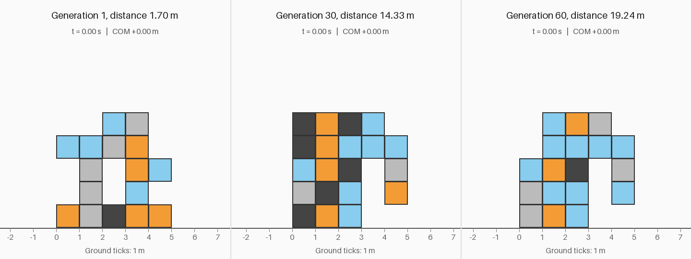
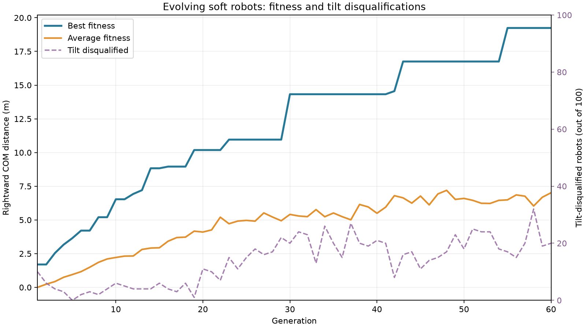
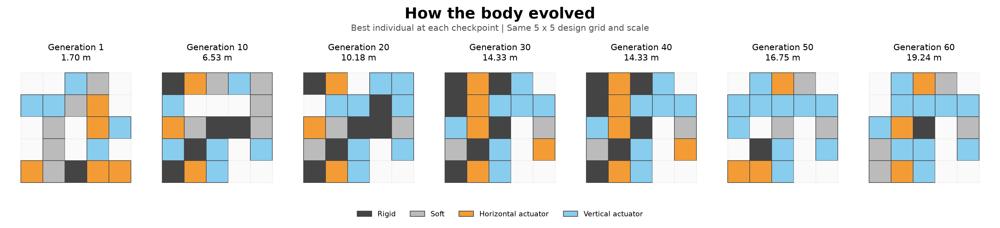
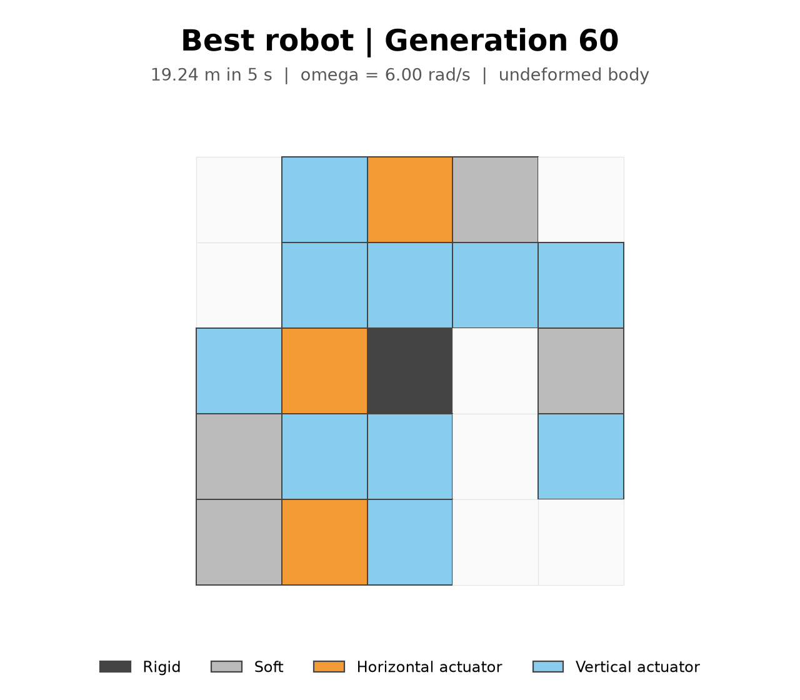
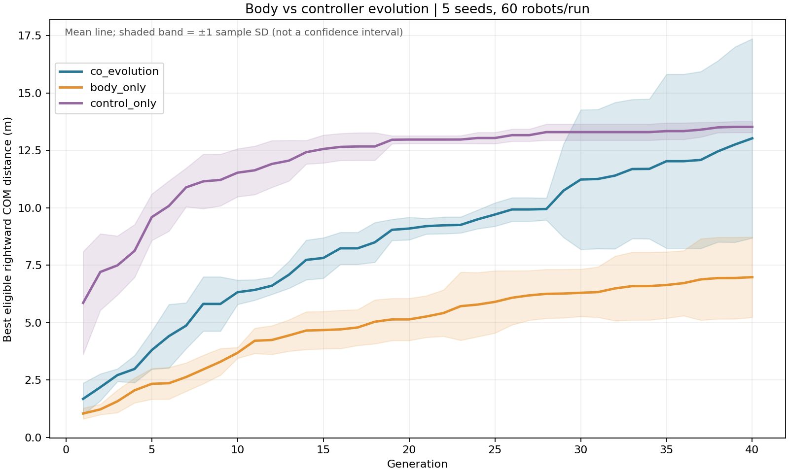
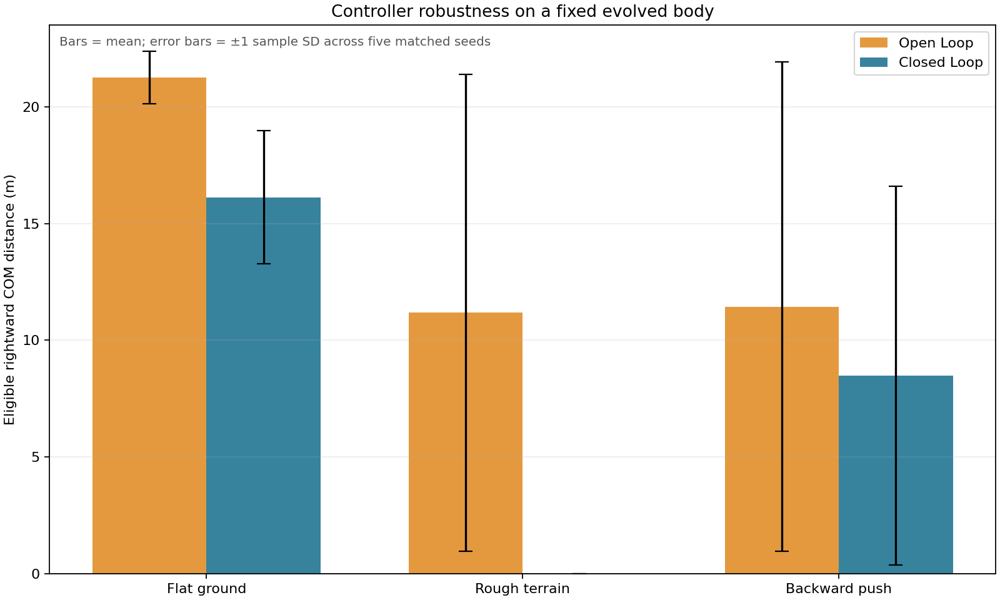
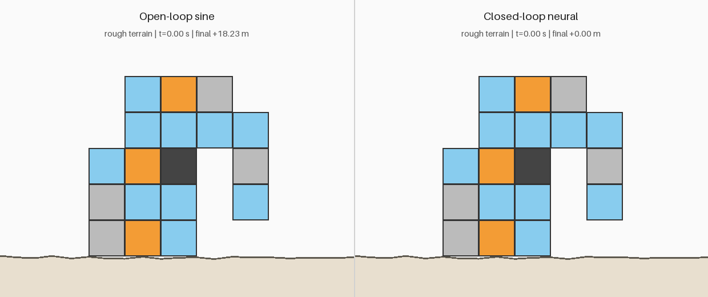

[English](README.md) | [繁體中文](README.zh-TW.md)

[Open the interactive web demo](https://technocrat94.github.io/evolving-soft-robots/)

# Evolving Soft Robots

A Python portfolio project that evolves the **body materials and motion** of voxel robots using a custom 2D mass-spring simulator and a genetic algorithm.



Built from scratch with **NumPy, Matplotlib and Pillow**—no physics engine. The final robot travels **19.24 m in five simulated seconds**, compared with **1.70 m** for generation 1, using a galloping/hopping gait.

## How it works

### Mass-spring physics

A robot is an integer grid up to 5 × 5. Row zero is the top. Each occupied voxel is a unit square with four corner point masses, four edge springs and two diagonal springs. Adjacent voxels **share corners and edges**; springs are never duplicated. Diagonals resist collapse and shear.

| Value | Material | Behavior |
|---|---|---|
| 0 | Empty | No voxel |
| 1 | Rigid, dark gray | Stiff springs |
| 2 | Soft, light gray | Weaker springs |
| 3 | Horizontal actuator, orange | Horizontal edge rest lengths oscillate |
| 4 | Vertical actuator, light blue | Vertical edge rest lengths oscillate |

For spring endpoints `a` and `b`, let `n` be the unit vector from `a` to `b`, `l` the current length and `L(t)` the target length:

```text
Force on a = [k (l − L(t)) + c ((v_b − v_a) · n)] n
Force on b = −Force on a
Actuator target: L(t) = L0 [1 + A sin(omega t + phase)]
Gravity: F_y = −m g
```

Stiffness and actuator modulation are averaged across the owners of a shared edge. Only matching horizontal or vertical edges actuate; diagonals do not. Each unique node has the same mass, rather than accumulating mass for each adjoining voxel.

Integration uses **semi-implicit Euler**:

```text
v_next = v + dt F / m
x_next = x + dt v_next
```

Defaults are `dt = 0.002 s`, `m = 0.1 kg`, gravity `9.81 m/s²`, and actuator amplitude `A = 0.2`. Each voxel is **1 m × 1 m in model units**; these are illustrative parameters, not a calibrated physical robot.

The floor is `y = 0`. Penetrating nodes are projected onto it, downward velocity is removed, and horizontal velocity is reduced by Coulomb friction:

```text
Normal impulse: Jn = m max(−v_y, 0)
Tangential impulse magnitude ≤ friction_coefficient × Jn
```

Spring damping acts along relative axial velocity. Springs incident on a grounded node receive additional damping to dissipate elastic energy near contact; the forces remain equal and opposite, without adhesive forces. Non-finite or excessive positions stop a simulation and return zero fitness. Spring-force accumulation is vectorized; there is no Python loop over springs inside the integration loop.

### Genetic algorithm

The genome contains a **5 × 5 material grid**, one actuator phase per voxel, and one global angular frequency `omega`. Valid bodies have at least one occupied voxel, four-neighbor connectivity and at least one actuator. Initialization regenerates random grids until valid.

Each generation:

1. Evaluate candidates using `multiprocessing.Pool` with spawn workers.
2. Rank by fitness and copy the top **20% unchanged**.
3. Choose parents by tournament selection.
4. Cross over a contiguous block of rows or columns, including phases.
5. Mutate materials, perturb phases and frequency, and clamp omega to **1–6 rad/s**.
6. Retry invalid children with a bounded retry count and a valid-parent fallback.

Eligible fitness is the **signed rightward center-of-mass displacement**:

```text
fitness = mean(x_final) − mean(x_initial)
```

Negative distances remain negative. Invalid, unstable or tilt-disqualified runs receive zero. The final actuation-disabled control is an audit measurement; it is not subtracted from fitness.

All tunable parameters live in [config.py](config.py). The original showcase used **100 robots and 60 generations**. Upgrade A defaults to **60 robots, 40 generations, seed 42 and all available CPU cores**. Random draws happen in the parent process, and ordered worker results make scheduling independent of selection. Floating-point differences across platforms or dependency versions can still change an evolutionary trajectory.

## Results





Generation 1 resembles an **unstable-looking arch that shuffles slowly**, although it passes the tilt rule. By generation 30, a **large body with a hooked front leg** has emerged. Generation 60 keeps that overall body plan while refining materials and motion. In this run, evolution first finds a useful body plan, then fine-tunes it; the timeline shows selected best individuals rather than a complete ancestry.

Best fitness plateaus at **14.33 m from generations 30–40**, followed by a breakthrough visible at the generation-45 checkpoint. The complete log places renewed improvement at generation **42**, with a larger jump at **43**. This is a punctuated pattern of improvement—an analogy to **punctuated equilibrium**, not evidence for a biological mechanism.



The final robot uses a **galloping/hopping gait**. Its coordinated actuation alternates support and airborne motion, and omega reaches the allowed upper limit of **6 rad/s**.

| Measurement | Recorded result |
|---|---:|
| Generation 1 best distance | 1.696913 m |
| Generation 30 best distance | 14.325100 m |
| Generation 60 best distance | **19.239387 m** |
| Final maximum sampled tilt | 19.325716° |
| Final time with at least one grounded node | 46.12% |
| Final distance with actuation disabled | 0.078180 m |
| Full-run wall time, including GIFs and final audit | 107.262 s |

Runtime was measured on the development macOS machine with 10 CPU cores and Python 3.12.14; it is not a performance guarantee. Saved scores come from that recorded run; the pinned dependencies provide a tested release environment.

## Experiments (Upgrade A)

The original **100 × 60, seed-42 showcase** above is preserved. This separate ablation study uses **60 robots × 40 generations**, the same five seeds **42, 43, 44, 45, 46**, and all available CPU cores for each of three conditions:

| Condition | Evolved | Held fixed |
|---|---|---|
| `body_only` | Body materials/topology | omega = 3 rad/s; all phases = 0 |
| `control_only` | Phases and omega | The hand-designed 4-row × 3-column Step 1 body |
| `co_evolution` | Body and controller | Neither |

The five co-evolution runs serve both the multi-seed experiment and the ablation; they are not counted twice. All conditions use identical simulation duration, physics, contact damping, tilt rule, selection/elitism settings, and evaluation budget: **2,400 candidate evaluations per run**, **36,000 total**. Frozen genes are enforced after initialization and every variation step. Five seeds quantify optimizer variability, not generalization to other tasks or terrains.



Lines show mean best eligible fitness; shaded bands show **±1 sample standard deviation (`ddof=1`) across five runs**, not a confidence interval.

| Condition | Final best distance, mean ± sample SD (m) | Seeds |
|---|---:|---:|
| co_evolution | 13.026 ± 4.337 | 5 |
| body_only | 6.981 ± 1.749 | 5 |
| control_only | 13.525 ± 0.241 | 5 |

`control_only` has the largest observed mean in this study. Interpret this descriptively: the body-only controller and control-only body are specific baselines, not optimal fixed choices. The showcase has a different budget and is excluded from these statistics. The fixed-body baseline has a slightly higher observed mean and much lower spread; joint search finds the best individual (20.768 m), but does not improve the observed mean within this budget.

**Passive-drift caveat:** some body-only winners move appreciably without actuation; their raw fitness may include movement from settling as well as powered locomotion. No post-hoc passive subtraction or exclusion was applied. One body-only passive control topples; its 3.247 m is raw displacement, not eligible fitness, while the active robot passes the tilt rule.

**Statistical comparison.** We use an exact **paired, two-sided sign-flip test** of mean final-distance differences, blocking by seed. It enumerates all **32** within-pair label swaps/sign patterns in NumPy, with no SciPy runtime dependency or Monte Carlo error. Under the null it assumes exchangeable condition labels within each seed pair (equivalently, independent symmetric paired differences about zero). See the [paired-permutation method reference](https://docs.scipy.org/doc/scipy/reference/generated/scipy.stats.permutation_test.html). Holm adjustment covers the two planned comparisons.

co_evolution vs body_only: raw p = 0.0625, Holm-adjusted p = 0.1250; co_evolution vs control_only: raw p = 0.8125, Holm-adjusted p = 0.8125.

**Neither comparison is significant at alpha = 0.05 after adjustment.** With only five pairs, the smallest possible two-sided raw p-value is **0.0625**, even if all differences have the same sign. Thus this design has coarse p-value resolution and low inferential power; the results do not establish superiority. More independent seeds and tasks are needed before stronger claims.

**Validation.** Audited 36,000 evaluations: 0 numerically unstable, 1,549 tilt-disqualified. All 600 saved best genomes satisfy the appropriate frozen-gene constraints. Final active/passive metrics were saved for all 15 runs and independently repeated exactly. Passive distance ranges: co_evolution: 0.0057 to 0.0162 m; body_only: 0.4564 to 3.2467 m; control_only: 0.0000 to 0.0000 m. The passive audit is reported rather than subtracted from the objective, and does not rule out every contact or self-collision exploit.

Total study runtime: **760.718 s** including 120 preview GIFs, final audits and aggregation on the development machine. [Per-seed results and passive checks](assets/ablation_runs.csv), [summary CSV](assets/ablation_table.csv), [Markdown table](assets/ablation_table.md), [statistics](assets/ablation_statistics.json), [curve data](assets/ablation_curves.csv) and [validation](assets/ablation_validation.json) are tracked. Large run folders remain ignored under `results/experiments/`.

Reproduce the full study or reanalyze a saved study:

```sh
python experiments.py
python experiments.py --analyze results/experiments/run_YYYYMMDD_HHMM
```

An individual condition can also be run with `python evolve.py --condition body_only --seed 42` (or `control_only` / `co_evolution`). Study outputs are written both to its timestamped results folder and to `assets/`; the original showcase media are not replaced.

## Closed-loop control (Upgrade B)

The original controller is **open-loop**: fixed sine waves receive no feedback. Control theory motivates feedback for disturbance rejection, but a sensor-connected policy must still learn a useful response. We test that distinction with neuroevolution rather than gradient training.

Every 10 physics steps (0.02 s), a **7 → 8 tanh → actuator-count tanh** network reads body tilt, angular velocity, COM vertical velocity, front/back contact flags, and `sin(omega*t)` / `cos(omega*t)`. Tilt is divided by pi, angular velocity by 10, and vertical velocity by 5. The front half is defined by starting-node x relative to the COM; contact uses local terrain height. Outputs are held between updates and scaled to the same **0.2** rest-length amplitude. Weights/biases and omega evolve; omega remains bounded to 1–6 rad/s.

Both families use the **fixed generation-60 showcase body**, five seeds (42–46), **60 candidates × 40 generations**, tournament selection and 20% elitism. Controller crossover is uniform; neural mutation perturbs 8% of weights/biases with Gaussian SD 0.15, while sine phases retain SD 0.25 perturbations. This matches evaluation budgets, not parameter counts or optimization difficulty. Both train only on flat ground; frozen winners face flat ground, rough terrain, and a backward push. Roughness is one reproducible piecewise-linear profile (seed 2026, 0.5 m spacing, heights 0–0.12 m); contact resolves velocity in local normal/tangent directions. The push applies **−1.5 m/s** to every node at **2.5 s**. Contact damping and the tilt rule are retained.



| Evaluation | Open-loop sine, mean ± SD (m) | Closed-loop neural, mean ± SD (m) | Tilt failures, sine / neural |
|---|---:|---:|---:|
| Flat | 21.262 ± 1.123 | 16.123 ± 2.858 | 0 / 0 |
| Rough | 11.174 ± 10.204 | 0.000 ± 0.000 | 2 / 5 |
| Backward push | 11.437 ± 10.490 | 8.475 ± 8.111 | 2 / 2 |

Distances are **eligible fitness**, with sustained tilt failures assigned zero; raw distances remain in the [per-seed table](assets/robustness_runs.csv). Error bars are sample SD across five optimizer seeds, not confidence intervals. Neural control **did not outperform sine control** in these observed means; all five neural winners fail on rough terrain. Possible explanations include flat-only training, many more neural parameters, limited search budget, a body already optimized for sine actuation, and no explicit disturbance-rejection objective. These results do not show that feedback in general is ineffective. One rough profile and one push magnitude cannot establish broad robustness; a clock-enabled network may rely heavily on its clock rather than sensors.



The GIF uses preselected seed 42 for both families. The exported neural robot is selected by **flat training fitness**, never by rough/push performance. All **24,000** candidate evaluations were stable; **8,308** were tilt-disqualified. All **400** checkpoints retained the fixed body and omega bounds; all ten final training scores reproduced independently. Active and actuation-disabled audits cover all **30** winner/environment combinations. Study time: **360.247 s**, including audits and GIF/plot generation, calculated from completed sine runs plus the corrected neural/aggregation run; an interrupted diagnostic batch is excluded. Raw folders are ignored; [summary CSV](assets/robustness_table.csv), [validation](assets/robustness_validation.json), and [manifest](assets/robustness_manifest.json) are tracked.

```sh
python robustness.py
python verify_robustness.py --study results/experiments/robustness/run_YYYYMMDD_HHMM
```

## Validation

- **Tilt rule:** the best-fit rotation of all nodes relative to the starting body is checked every `0.02 s`. More than **30°** of tilt sustained for **0.2 s** disqualifies the run. This discourages falling and sliding; it is a conservative heuristic, not a guarantee against every possible exploit.
- **Actuation-disabled check:** rerun the same final body from the same initial state with actuator amplitude zero. It moves **0.078180 m**, compared with **19.239387 m** actively. The passive distance is raw displacement even if a passive run would fail the tilt rule.
- **Stability:** all **6,000 candidate evaluations** in the full run stayed finite and within the simulator's safety bounds. The tilt rule disqualified **820 evaluations**, including repeated genomes across generations; no evaluation was numerically unstable.
- **Tests:** 15 unit tests cover shared mesh topology, valid bodies, repeatability, ground contact, dense-body stability, frequency bounds, unchanged elites, saved-genome reloads, fall disqualification, frozen-gene constraints and exact statistics.

The curated CSV retains each generation's `best`, `average` and `tilt_disqualified` values. Supporting metrics and the original full-run integrity summary are included under `assets/`; large raw results are excluded.

## Interactive web demo (Upgrade C)

The [browser lab](https://technocrat94.github.io/evolving-soft-robots/) runs plain HTML, CSS and JavaScript from `docs/`, with no framework or build step. Watch generations 1, 30 and 60 side by side, pause/restart them, or edit a 5 × 5 body and try omega from 1–6 rad/s. Clicking cycles empty → rigid → soft → horizontal actuator → vertical actuator. Custom bodies use synchronized sine phases; invalid or disconnected bodies are rejected. The page supports English and Traditional Chinese and includes the three experiment figures.

`export_robots.py` exports the showcase checkpoints and the best flat-trained neural controller to `docs/robots.json`, including physical constants and a reproducible rough profile. The JavaScript simulator also supports neural control, rough ground and pushes. Node replay of all four exported robots matches Python within **4 × 10⁻¹³ percent** relative error in this environment—well within the requested 10% tolerance. This is a numerical parity check, not physical validation. [Exact comparison](assets/js_parity.csv).

```sh
python export_robots.py
node docs/validate.js
python -m http.server 8000 --directory docs
# Open http://localhost:8000
```

GitHub Pages serves the `main` branch's `/docs` directory. Re-export after changing checkpoints, controllers, physics constants or result figures; commit the resulting files. Opening `index.html` directly with a `file://` URL can block the JSON fetch, so use HTTP locally.

## How to run

Requires **Python 3.10+**. Commands below use `python`; on some macOS/Linux setups use `python3` instead. First clone your repository and enter its directory:

```sh
git clone https://github.com/technocrat94/evolving-soft-robots.git
cd evolving-soft-robots
python -m venv .venv
```

Activate the environment on macOS/Linux:

```sh
source .venv/bin/activate
```

Or on Windows PowerShell:

```powershell
.venv\Scripts\Activate.ps1
```

Install dependencies and run tests:

```sh
python -m pip install -r requirements.txt
python -m unittest discover -v
```

Run the hand-designed demonstration, then the small evolution test:

```sh
python main.py
python evolve.py --small
```

`main.py` saves `preview_step1.gif` and prints distance and physics runtime. `--small` runs 10 robots for five generations without changing the full-run defaults.

Run the full experiment:

```sh
python evolve.py
```

This creates a fresh `results/run_YYYYMMDD_HHMM/` directory (with a suffix on collisions), saves the best genome every generation and a GIF every five generations, and writes fitness history, per-candidate diagnostics, configuration, timing and final active/passive metrics. Timestamps use Taipei time. Existing results are never overwritten. To limit CPU usage or change the seed:

```sh
python evolve.py --workers 4 --seed 42
```

Regenerate the README visuals immediately using the **seven bundled checkpoints**, without rerunning evolution:

```sh
python visualize.py --run assets/checkpoints
```

To render another 60-generation showcase, first set `GENERATIONS = 60` in `config.py`, run evolution, then replace the example timestamp below. The default 40-generation experiments use their own ablation renderer:

```sh
python visualize.py --run results/run_YYYYMMDD_HHMM
```

Visualization expects generations 1, 10, 20, 30, 40, 50 and 60, so a five-generation smoke test is not sufficient. Use the configuration that produced a run: the renderer checks comparison fitness against saved values. The bundled GIF uses 125 frames at 25 FPS with equal scale and duration across all panels.

## Project structure

```text
evolving-soft-robots/
├── config.py               # Physics, evolution and rendering parameters
├── sim.py                  # Shared-node mesh, physics, contact and tilt checks
├── evolve.py               # Genome, selection, mutation, multiprocessing and audit
├── visualize.py            # GIFs, fitness plot, body image and timeline
├── experiments.py          # Matched-seed ablations, aggregation and exact statistics
├── controllers.py          # Sensors, neural policy and reproducible terrain
├── robustness.py           # Fixed-body feedback experiment and robustness audits
├── verify_robustness.py    # Independent checkpoint and winner replay checks
├── export_robots.py        # Portable web data and Python reference scores
├── docs/                   # Static bilingual web demo and Node parity checker
├── main.py                 # Hand-designed robot demonstration
├── test_sim.py             # Physics and mesh tests
├── test_evolve.py          # Evolution and audit tests
├── test_experiments.py     # Frozen-gene and statistical checks
├── assets/                 # README media, curated metrics and validation summaries
│   └── checkpoints/        # Seven best genomes, fitness CSV and configuration
├── README.md               # English documentation
├── README.zh-TW.md         # Traditional Chinese documentation
├── requirements.txt        # Pinned direct dependencies
├── LICENSE                 # MIT
└── .gitignore              # Excludes raw results, caches and local environments
```

`results/` is generated locally and ignored by Git. The small curated checkpoints remain tracked inside `assets/`. No working environment or large experiment folder is bundled.

## Limitations

- **No self-collision:** limbs can slightly pass through the body; ground contact is modeled, robot-to-robot-part contact is not.
- **2D only:** out-of-plane motion, 3D stability and real material behavior are not represented.
- **Frequency bound reached:** omega finishes at **6 rad/s**, suggesting selection pressure toward the allowed limit. It is not evidence that 6 rad/s is a physical optimum.
- **Simplified mechanics:** lumped equal node masses, linear springs, projected contact and fixed-step integration are illustrative approximations. These results do not certify hardware performance.
- **Hopping is allowed:** no minimum ground-contact percentage is enforced. The final winner is airborne for a substantial fraction of time.
- **Validation scope:** direct execution was tested on macOS. Spawn-safe entry points support Windows/Linux usage, but those platforms have not been directly tested.

## What I learned

*Personal reflection placeholders—replace these with your own experience.*

- [ ] Explain what building a mass-spring model taught me about stiffness, damping and timestep stability.
- [ ] Describe how friction, contact and shared mesh topology affected locomotion.
- [ ] Reflect on fitness exploits, passive controls and interpreting evolutionary plateaus.
- [ ] Describe one debugging decision and one design tradeoff I would approach differently.

## Future work

*Choose and expand the directions that interest you.*

- [ ] Add different terrains, slopes and rough surfaces.
- [ ] Evolve jumping or climbing tasks.
- [ ] Compare evolved bodies with topology optimization.
- [ ] Add self-collision and investigate more realistic contact models.
- [ ] Compare multiple seeds and perform timestep-convergence studies.
- [ ] Extend the simulator to 3D.

## License

[MIT](LICENSE).
