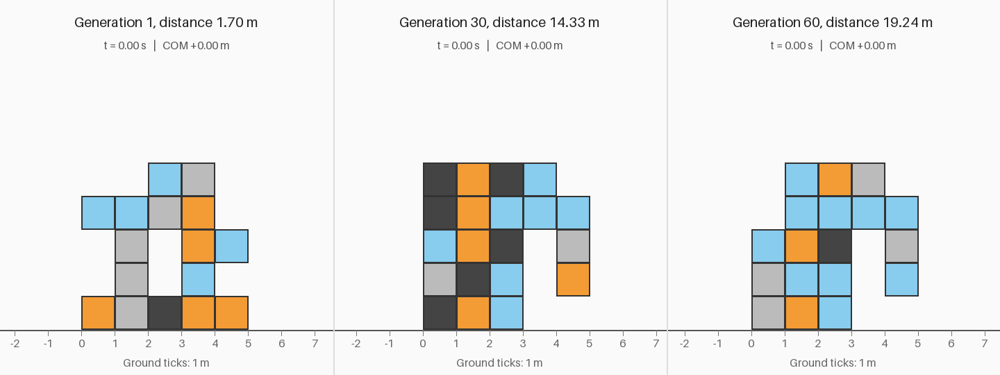
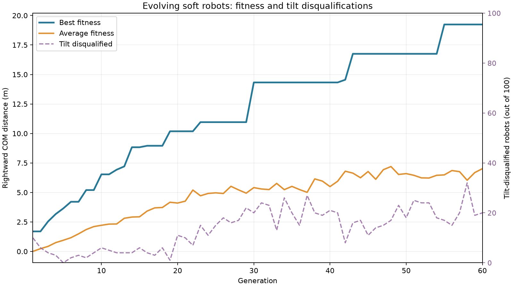
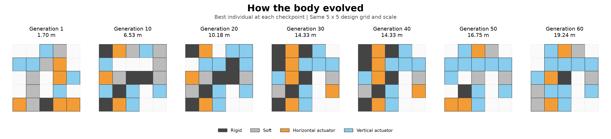
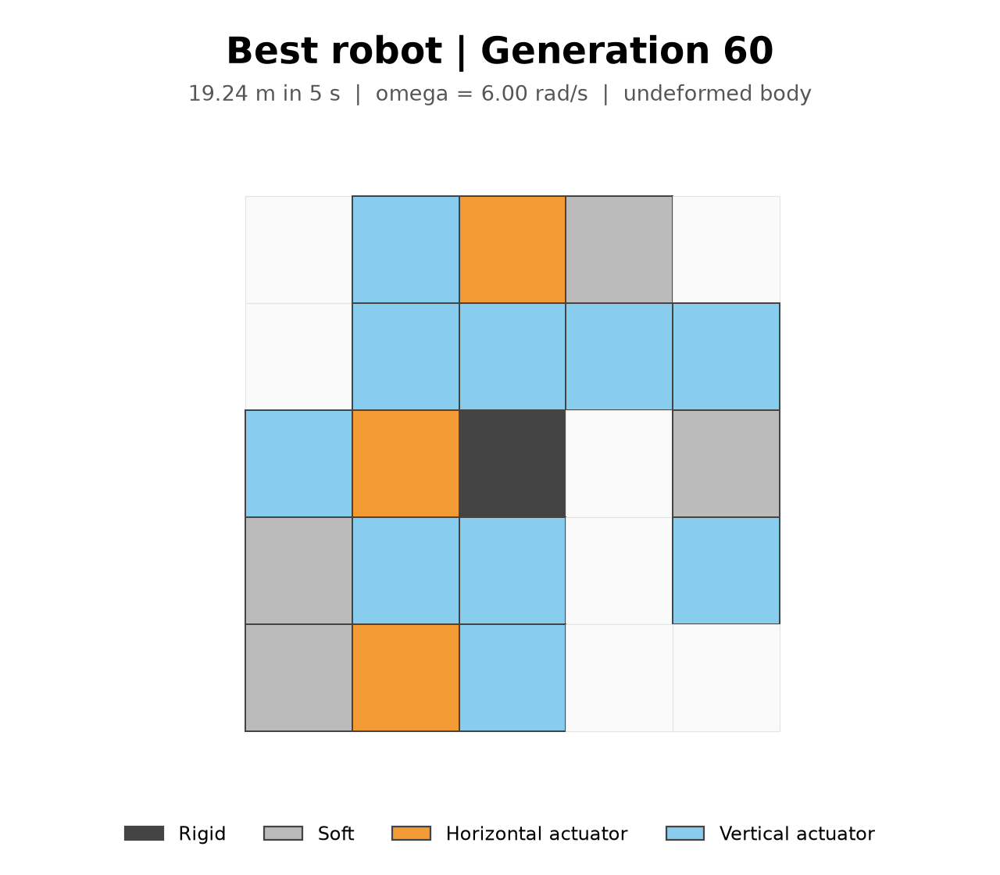
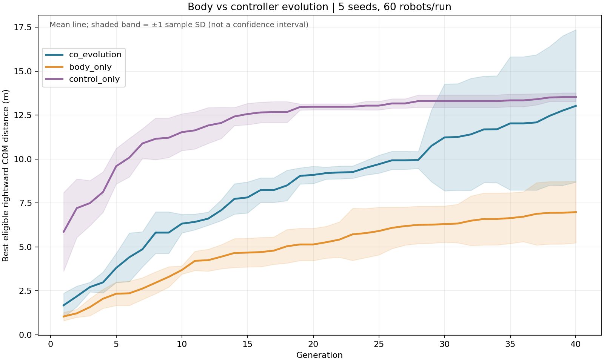

[English](README.md) | [繁體中文](README.zh-TW.md)

# 演化軟體機器人（Evolving Soft Robots）

這是一個 Python 作品集專案，透過自行實作的二維質點彈簧模擬器與遺傳演算法，同時演化體素機器人的**身體材料配置與運動方式**。



從零開始使用 **NumPy、Matplotlib 與 Pillow** 實作，未使用物理引擎。最終機器人採用奔躍／跳躍步態，在五秒模擬時間內前進 **19.24 公尺**；第 1 代最佳個體則前進 **1.70 公尺**。

## 運作原理

### 質點彈簧物理模型

機器人以最大 5 × 5 的整數網格表示，第零列位於最上方。每個非空體素是一個單位正方形，具有四個角點質量、四條邊彈簧與兩條對角彈簧。相鄰體素**共用角點與邊**，不會重複建立彈簧；對角彈簧用於抵抗塌陷與剪切變形。

| 數值 | 材料 | 行為 |
|---|---|---|
| 0 | 空白 | 不建立體素 |
| 1 | 剛性材料，深灰色 | 較高彈簧剛性 |
| 2 | 柔性材料，淺灰色 | 較低彈簧剛性 |
| 3 | 水平致動器，橘色 | 水平邊彈簧的自然長度週期變化 |
| 4 | 垂直致動器，淺藍色 | 垂直邊彈簧的自然長度週期變化 |

對於兩端為 `a`、`b` 的彈簧，令 `n` 為由 `a` 指向 `b` 的單位向量、`l` 為當前長度、`L(t)` 為目標長度：

```text
a 端受力 = [k (l − L(t)) + c ((v_b − v_a) · n)] n
b 端受力 = −a 端受力
致動目標：L(t) = L0 [1 + A sin(omega t + phase)]
重力：F_y = −m g
```

共用邊的剛性與致動調變量，會依所屬體素取平均。只有對應的水平或垂直邊會被致動，對角彈簧不致動。每個獨立節點具有相同質量，不會依相鄰體素數量累加。

積分採用**半隱式 Euler 法**：

```text
v_next = v + dt F / m
x_next = x + dt v_next
```

預設值為 `dt = 0.002 秒`、`m = 0.1 公斤`、重力加速度 `9.81 m/s²`，以及致動振幅 `A = 0.2`。每個體素在**模型單位中為 1 公尺 × 1 公尺**；這些參數用於示範，並非經過實體機器人校正的數值。

地面位於 `y = 0`。穿透地面的節點會被投影回地面，向下速度歸零，並依庫侖摩擦減少水平速度：

```text
法向衝量：Jn = m max(−v_y, 0)
切向衝量大小 ≤ 摩擦係數 × Jn
```

彈簧阻尼沿相對軸向速度作用。連接接地節點的彈簧會增加額外阻尼，以耗散接觸附近的彈性能量；兩端受力仍大小相等、方向相反，不引入黏著力。若位置出現非有限值或超出安全範圍，模擬立即停止，適應度回傳零。彈簧力累加採向量化計算，積分迴圈內沒有逐條彈簧的 Python 迴圈。

### 遺傳演算法

基因組包含 **5 × 5 材料網格**、每個體素的一個致動相位，以及一個全域角頻率 `omega`。有效身體須至少有一個非空體素、所有非空體素以四鄰接連通，且至少包含一個致動器。初始化時會反覆產生隨機網格，直到符合條件。

每一代依序執行：

1. 透過採用 spawn 啟動方式的 `multiprocessing.Pool` 評估個體。
2. 依適應度排序，將前 **20% 原樣保留**。
3. 使用錦標賽選擇挑選親代。
4. 交換一段連續的列或欄，連同對應相位一起交配。
5. 突變材料、擾動相位與頻率，並將 omega 限制在 **1–6 rad/s**。
6. 對無效子代進行有限次重試；若仍失敗，使用有效親代身體作為備援。

符合條件的個體，其適應度就是**質心向右的帶正負號位移**：

```text
fitness = mean(x_final) − mean(x_initial)
```

向左位移保留為負值。無效、數值不穩定或因傾倒被取消資格的個體，適應度為零。最終關閉致動器的對照測試是一項驗證量測，不會從適應度中扣除。

所有可調參數集中於 [config.py](config.py)。原始展示實驗使用 **100 個體、60 代**。Upgrade A 預設為 **60 個體、40 代、隨機種子 42，並使用所有可用 CPU 核心**。隨機抽樣集中在主行程，工作行程的結果依固定順序回收，因此排程不會影響選擇。跨平台或相依套件版本的浮點差異，仍可能改變演化軌跡。

## 結果





第 1 代看起來像一座**不穩固的拱形結構，只能緩慢挪動**，但仍通過傾倒判定。到第 30 代，已出現**較大的身體與鉤狀前肢**。第 60 代保留同樣的整體身體架構，再改良材料分布與運動控制。這次演化先找到有用的身體架構，再進行細部調整；時間軸呈現的是各檢查點的最佳個體，而非完整親緣譜系。

最佳適應度在**第 30–40 代停滯於 14.33 公尺**，之後的突破在第 45 代檢查點已清楚可見。完整紀錄顯示，第 **42** 代恢復進步，第 **43** 代出現更大的提升。這種間歇式進展可以類比為**間斷平衡（punctuated equilibrium）**，但不代表已證實任何生物演化機制。



最終機器人採用**奔躍／跳躍步態**，透過協調致動交替出現支撐與騰空階段；omega 最終達到允許上限 **6 rad/s**。

| 量測項目 | 紀錄結果 |
|---|---:|
| 第 1 代最佳位移 | 1.696913 公尺 |
| 第 30 代最佳位移 | 14.325100 公尺 |
| 第 60 代最佳位移 | **19.239387 公尺** |
| 最終個體最大取樣傾角 | 19.325716° |
| 最終個體至少一個節點接地的時間比例 | 46.12% |
| 最終個體關閉致動器後的位移 | 0.078180 公尺 |
| 完整演化實際耗時，含 GIF 與最終驗證 | 107.262 秒 |

耗時是在具備 10 個 CPU 核心、Python 3.12.14 的開發用 macOS 電腦上量測，不保證其他環境具有相同效能。顯示的分數來自已記錄的完整實驗；固定版本的相依套件則提供經測試的發行環境。

## 實驗（Upgrade A）

保留上方原始的 **100 個體 × 60 代、種子 42 展示結果**。這項獨立消融研究對下列三種條件，各使用 **60 個體 × 40 代**、相同五個種子 **42、43、44、45、46**，並讓每次實驗使用所有可用 CPU 核心：

| 條件 | 參與演化 | 保持固定 |
|---|---|---|
| `body_only` | 身體材料與拓撲 | omega = 3 rad/s；所有相位 = 0 |
| `control_only` | 相位與 omega | Step 1 手工設計的 4 列 × 3 欄身體 |
| `co_evolution` | 身體與控制器 | 兩者皆不固定 |

五次共同演化同時用於多種子研究與消融比較，不重複計數。各條件採用相同的模擬時長、物理、接觸阻尼、傾倒規則、選擇與菁英保留設定，以及評估預算：**每次 2,400 次個體評估，共 36,000 次**。初始化與每次基因變動後都會強制維持固定基因。五個種子反映最佳化器的變異，不代表能泛化到其他任務或地形。



曲線為五次實驗的最佳有效適應度平均值；陰影為**正負一個樣本標準差（`ddof=1`）**，不是信賴區間。

| 條件 | 最終最佳位移，平均值 ± 樣本標準差（公尺） | 種子數 |
|---|---:|---:|
| co_evolution | 13.026 ± 4.337 | 5 |
| body_only | 6.981 ± 1.749 | 5 |
| control_only | 13.525 ± 0.241 | 5 |

此研究中，`control_only` 的觀察平均值最高。這是描述性結果：body_only 的固定控制器與 control_only 的固定身體都是特定基準，不代表最佳固定選擇。展示實驗的預算不同，未納入統計。固定身體基準的觀察平均值略高、變異明顯較小；共同搜尋找到最佳單一個體（20.768 公尺），但在此預算內未提高觀察平均值。

**被動漂移限制：**部分 body_only 最佳個體即使不致動也會明顯移動，因此原始適應度可能含有姿態沉降及主動移動。沒有事後扣除被動位移或剔除個體。其中一個 body_only 被動對照發生傾倒；其 3.247 公尺是原始位移，不是有效適應度，而主動個體通過傾倒規則。

**統計比較。**以種子配對，對最終距離差的平均值進行**精確、雙尾的配對符號翻轉檢定**。使用 NumPy 列舉全部 **32** 種配對內標籤交換／符號組合，不依賴 SciPy 執行，也沒有蒙地卡羅抽樣誤差。虛無假設下，假定每個種子配對內的條件標籤可交換，或等價地，配對差值彼此獨立且關於零對稱。方法參見[配對置換檢定說明](https://docs.scipy.org/doc/scipy/reference/generated/scipy.stats.permutation_test.html)。兩個預先規劃的比較使用 Holm 校正。

co_evolution vs body_only: raw p = 0.0625, Holm-adjusted p = 0.1250; co_evolution vs control_only: raw p = 0.8125, Holm-adjusted p = 0.8125。

**校正後，兩項比較在 alpha = 0.05 下皆不顯著。**只有五個配對時，即使所有差值同號，雙尾原始 p 值最小也只能達到 **0.0625**。因此這個設計的 p 值解析度粗、推論力有限，結果無法確立哪種方法較優。做出較強結論前，需要更多獨立種子與任務。

**驗證。**檢核 36,000 次評估：0 次數值不穩定，1,549 次因傾倒取消資格。600 個儲存的最佳基因組皆符合各條件的固定基因要求。15 次實驗皆儲存最終主動／被動指標，並經獨立重跑完全一致。被動位移範圍：co_evolution: 0.0057 to 0.0162 m; body_only: 0.4564 to 3.2467 m; control_only: 0.0000 to 0.0000 m。被動對照僅供驗證，不從目標函數扣除，也無法排除所有接觸或自碰撞相關取巧。

研究總耗時為 **760.718 秒**，包含在開發電腦上產生 120 支預覽 GIF、最終驗證與彙整。[逐種子與被動對照資料](assets/ablation_runs.csv)、[摘要 CSV](assets/ablation_table.csv)、[Markdown 表格](assets/ablation_table.md)、[統計結果](assets/ablation_statistics.json)、[曲線資料](assets/ablation_curves.csv)與[檢核摘要](assets/ablation_validation.json)納入版本追蹤。大型實驗目錄位於被忽略的 `results/experiments/`。

重現完整研究，或重新分析已儲存的研究：

```sh
python experiments.py
python experiments.py --analyze results/experiments/run_YYYYMMDD_HHMM
```

也可使用 `python evolve.py --condition body_only --seed 42` 單獨執行某條件，或改用 `control_only`／`co_evolution`。研究輸出會同時存入帶時間戳記的結果目錄及 `assets/`；不會取代原始展示圖片。

## 驗證

- **傾倒規則：**每 `0.02 秒`，利用所有節點相對初始身體的最佳擬合旋轉估計傾角。傾角超過 **30° 且持續 0.2 秒**即取消資格。此規則用來抑制倒下後滑行得分，是保守的啟發式判斷，無法保證排除所有可能的取巧行為。
- **關閉致動器測試：**同一個最終身體從相同初始狀態重新模擬，將致動振幅設為零。其位移為 **0.078180 公尺**，主動致動時則為 **19.239387 公尺**。即使被動模擬未通過傾倒規則，這裡仍紀錄原始位移。
- **穩定性：**完整演化的 **6,000 次個體評估**皆維持有限數值，且未超出模擬器安全範圍。其中 **820 次評估**因傾倒取消資格，包含不同世代重複評估相同基因組；沒有任何一次評估出現數值不穩定。
- **測試：**15 項單元測試涵蓋共用網格拓撲、身體有效性、可重現性、地面接觸、密集身體穩定性、頻率邊界、菁英原樣保留、基因組存取、傾倒取消資格、固定基因約束及精確統計。

精簡 CSV 保留每一代的 `best`、`average` 與 `tilt_disqualified`。輔助指標與原始完整實驗的檢核摘要也保存在 `assets/`；大型原始結果不納入儲存庫。

## 執行方式

需要 **Python 3.10 以上**。以下使用 `python`；部分 macOS／Linux 環境請改用 `python3`。先複製自己的儲存庫並進入目錄：

```sh
git clone https://github.com/technocrat94/evolving-soft-robots.git
cd evolving-soft-robots
python -m venv .venv
```

在 macOS／Linux 啟用虛擬環境：

```sh
source .venv/bin/activate
```

或在 Windows PowerShell 啟用：

```powershell
.venv\Scripts\Activate.ps1
```

安裝相依套件並執行測試：

```sh
python -m pip install -r requirements.txt
python -m unittest -v test_sim test_evolve test_experiments
```

執行手工設計機器人示範，再執行小規模演化測試：

```sh
python main.py
python evolve.py --small
```

`main.py` 會儲存 `preview_step1.gif`，並印出位移與物理模擬耗時。`--small` 使用 10 個體、5 代，不會修改完整演化的預設值。

執行完整實驗：

```sh
python evolve.py
```

程式會建立新的 `results/run_YYYYMMDD_HHMM/` 目錄；若名稱重複則加上後綴。每代儲存最佳基因組，每五代儲存一支 GIF，並寫出適應度歷史、逐個體診斷、設定、耗時與最終主動／被動對照指標。時間戳記使用臺北時間，既有結果不會被覆寫。如需限制 CPU 使用量或修改隨機種子：

```sh
python evolve.py --workers 4 --seed 42
```

使用隨附的**七個檢查點**立即重新產生 README 圖片，不必重新執行演化：

```sh
python visualize.py --run assets/checkpoints
```

若要繪製另一個 60 代展示實驗，請先在 `config.py` 將 `GENERATIONS` 設為 `60`，執行演化後，再將下方時間戳記替換為新結果目錄。預設的 40 代實驗使用專屬消融圖表程式：

```sh
python visualize.py --run results/run_YYYYMMDD_HHMM
```

視覺化需要第 1、10、20、30、40、50、60 代，因此只有五代的小規模測試不足以產生完整圖組。請使用產生該實驗的設定；繪圖程式會核對比較動畫的適應度與儲存值是否一致。隨附 GIF 以每秒 25 格播放 125 格，所有面板使用相同比例與播放時長。

## 專案結構

```text
evolving-soft-robots/
├── config.py               # 物理、演化與繪圖參數
├── sim.py                  # 共用節點網格、物理、接觸與傾倒檢查
├── evolve.py               # 基因組、選擇、突變、多行程與驗證
├── visualize.py            # GIF、適應度圖、身體圖與演化時間軸
├── experiments.py          # 配對種子消融實驗、彙整與精確統計
├── main.py                 # 手工設計機器人的示範
├── test_sim.py             # 物理與網格測試
├── test_evolve.py          # 演化與驗證測試
├── test_experiments.py     # 固定基因與統計檢查
├── assets/                 # README 圖片、精簡指標與檢核摘要
│   └── checkpoints/        # 七個最佳基因組、適應度 CSV 與設定
├── README.md               # 英文說明
├── README.zh-TW.md         # 繁體中文說明
├── requirements.txt        # 固定版本的直接相依套件
├── LICENSE                 # MIT 授權
└── .gitignore              # 排除原始結果、快取與本機環境
```

`results/` 會在本機產生，並由 Git 忽略。少量精選檢查點保存在受版本追蹤的 `assets/` 內，不附帶工作環境或大型實驗目錄。

## 限制

- **沒有自碰撞：**肢體可能稍微穿過身體。模擬包含地面接觸，但不處理機器人不同部位之間的碰撞。
- **僅限二維：**未描述平面外運動、三維穩定性或真實材料行為。
- **頻率達到邊界：**omega 最終為 **6 rad/s**，顯示選擇壓力偏向允許範圍的上限，不表示 6 rad/s 是物理上的最佳頻率。
- **力學模型簡化：**等質量集中節點、線性彈簧、投影式接觸與固定步長積分都是示範性近似，結果不代表實體硬體效能認證。
- **允許跳躍：**未強制最低接地時間比例，最終個體有相當比例的時間處於騰空狀態。
- **驗證範圍：**已在 macOS 實際執行測試。程式使用適合 spawn 的進入點，以支援 Windows／Linux，但尚未在這兩個平台直接測試。

## 我的學習心得

*以下為個人反思預留欄位，請改寫成自己的實際經驗。*

- [ ] 說明建立質點彈簧模型，如何幫助我理解剛性、阻尼與時間步長穩定性。
- [ ] 描述摩擦、接觸與共用網格拓撲對移動方式的影響。
- [ ] 反思適應度取巧、被動對照測試與演化停滯期的解讀。
- [ ] 描述一次除錯決策，以及未來會如何重新權衡某個設計取捨。

## 未來工作

*選擇自己感興趣的方向，補充具體計畫。*

- [ ] 加入不同地形、斜坡與粗糙表面。
- [ ] 演化跳躍或攀爬任務。
- [ ] 將演化身體與拓撲最佳化結果比較。
- [ ] 加入自碰撞，並研究更真實的接觸模型。
- [ ] 比較多個隨機種子，進行時間步長收斂研究。
- [ ] 將模擬器擴充為三維版本。

## 授權

[MIT](LICENSE)。
