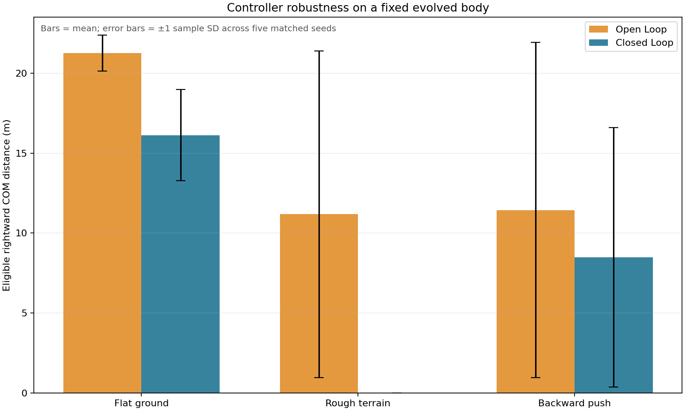
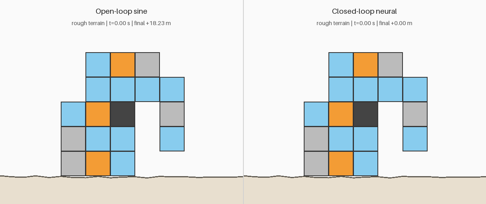
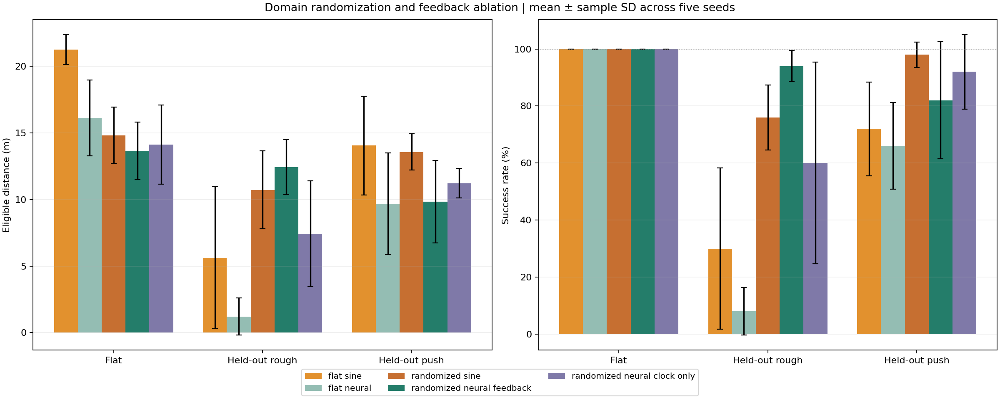
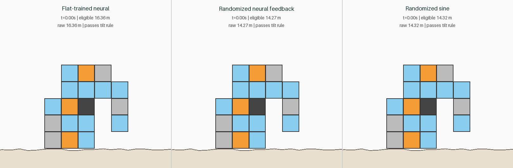
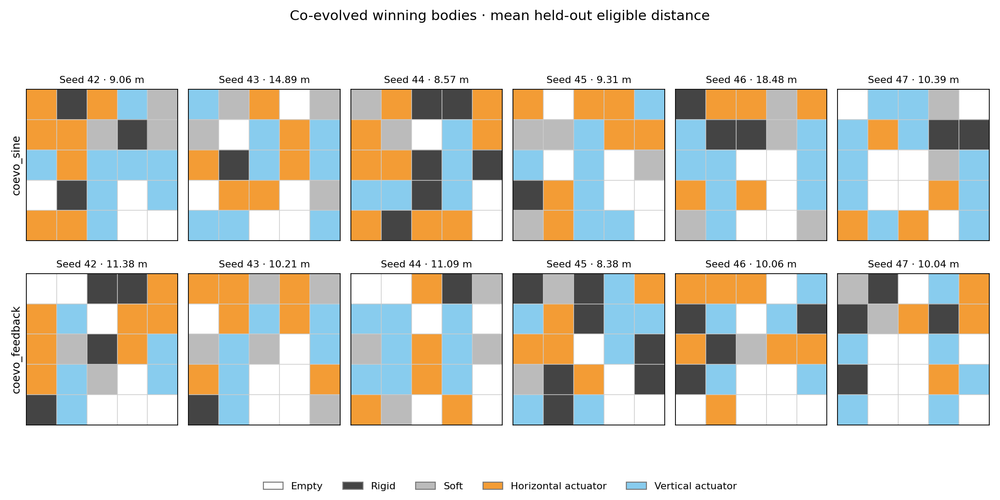

[English](README.md) | [繁體中文](README.zh-TW.md)

[開啟互動網頁展示](https://technocrat94.github.io/evolving-soft-robots/)

# 演化軟體機器人（Evolving Soft Robots）

這是一個 Python 作品集專案，透過自行實作的二維質點彈簧模擬器與遺傳演算法，同時演化體素機器人的**身體材料配置與運動方式**。


從零開始使用 **NumPy、Matplotlib 與 Pillow** 實作，未使用物理引擎。最終機器人採用奔躍／跳躍步態，在五秒模擬時間內前進 **19.24 公尺**；第 1 代最佳個體則前進 **1.70 公尺**。

## 運作原理

### 質點彈簧物理模型

機器人以最大 5 × 5 的整數網格表示，第零列位於最上方。每個非空體素是一個單位正方形，具有四個角點質量、四條邊彈簧與兩條對角彈簧。相鄰體素**共用角點與邊**，不會重複建立彈簧；對角彈簧用於抵抗塌陷與剪切變形。

| 數值 | 材料 | 行為 |
|---|---|---|
| 0 | 空白 | 不建立體素 |
| 1 | 剛性材料，深灰色 | 較高彈簧剛性 |
| 2 | 柔性材料，淺灰色 | 較低彈簧剛性 |
| 3 | 水平致動器，橘色 | 水平邊彈簧的自然長度週期變化 |
| 4 | 垂直致動器，淺藍色 | 垂直邊彈簧的自然長度週期變化 |

對於兩端為 `a`、`b` 的彈簧，令 `n` 為由 `a` 指向 `b` 的單位向量、`l` 為當前長度、`L(t)` 為目標長度：

```text
a 端受力 = [k (l − L(t)) + c ((v_b − v_a) · n)] n
b 端受力 = −a 端受力
致動目標：L(t) = L0 [1 + A sin(omega t + phase)]
重力：F_y = −m g
```

共用邊的剛性與致動調變量，會依所屬體素取平均。只有對應的水平或垂直邊會被致動，對角彈簧不致動。每個獨立節點具有相同質量，不會依相鄰體素數量累加。

積分採用**半隱式 Euler 法**：

```text
v_next = v + dt F / m
x_next = x + dt v_next
```

預設值為 `dt = 0.002 秒`、`m = 0.1 公斤`、重力加速度 `9.81 m/s²`，以及致動振幅 `A = 0.2`。每個體素在**模型單位中為 1 公尺 × 1 公尺**；這些參數用於示範，並非經過實體機器人校正的數值。

地面位於 `y = 0`。穿透地面的節點會被投影回地面，向下速度歸零，並依庫侖摩擦減少水平速度：

```text
法向衝量：Jn = m max(−v_y, 0)
切向衝量大小 ≤ 摩擦係數 × Jn
```

彈簧阻尼沿相對軸向速度作用。連接接地節點的彈簧會增加額外阻尼，以耗散接觸附近的彈性能量；兩端受力仍大小相等、方向相反，不引入黏著力。若位置出現非有限值或超出安全範圍，模擬立即停止，適應度回傳零。彈簧力累加採向量化計算，積分迴圈內沒有逐條彈簧的 Python 迴圈。

### 遺傳演算法

基因組包含 **5 × 5 材料網格**、每個體素的一個致動相位，以及一個全域角頻率 `omega`。有效身體須至少有一個非空體素、所有非空體素以四鄰接連通，且至少包含一個致動器。初始化時會反覆產生隨機網格，直到符合條件。

每一代依序執行：

1. 透過採用 spawn 啟動方式的 `multiprocessing.Pool` 評估個體。
2. 依適應度排序，將前 **20% 原樣保留**。
3. 使用錦標賽選擇挑選親代。
4. 交換一段連續的列或欄，連同對應相位一起交配。
5. 突變材料、擾動相位與頻率，並將 omega 限制在 **1–6 rad/s**。
6. 對無效子代進行有限次重試；若仍失敗，使用有效親代身體作為備援。

符合條件的個體，其適應度就是**質心向右的帶正負號位移**：

```text
fitness = mean(x_final) − mean(x_initial)
```

向左位移保留為負值。無效、數值不穩定或因傾倒被取消資格的個體，適應度為零。最終關閉致動器的對照測試是一項驗證量測，不會從適應度中扣除。

所有可調參數集中於 [config.py](config.py)。原始展示實驗使用 **100 個體、60 代**。Upgrade A 預設為 **60 個體、40 代、隨機種子 42，並使用所有可用 CPU 核心**。隨機抽樣集中在主行程，工作行程的結果依固定順序回收，因此排程不會影響選擇。跨平台或相依套件版本的浮點差異，仍可能改變演化軌跡。

## 結果


第 1 代看起來像一座**不穩固的拱形結構，只能緩慢挪動**，但仍通過傾倒判定。到第 30 代，已出現**較大的身體與鉤狀前肢**。第 60 代保留同樣的整體身體架構，再改良材料分布與運動控制。這次演化先找到有用的身體架構，再進行細部調整；時間軸呈現的是各檢查點的最佳個體，而非完整親緣譜系。

最佳適應度在**第 30–40 代停滯於 14.33 公尺**，之後的突破在第 45 代檢查點已清楚可見。完整紀錄顯示，第 **42** 代恢復進步，第 **43** 代出現更大的提升。這種間歇式進展可以類比為**間斷平衡（punctuated equilibrium）**，但不代表已證實任何生物演化機制。


最終機器人採用**奔躍／跳躍步態**，透過協調致動交替出現支撐與騰空階段；omega 最終達到允許上限 **6 rad/s**。

| 量測項目 | 紀錄結果 |
|---|---:|
| 第 1 代最佳位移 | 1.696913 公尺 |
| 第 30 代最佳位移 | 14.325100 公尺 |
| 第 60 代最佳位移 | **19.239387 公尺** |
| 最終個體最大取樣傾角 | 19.325716° |
| 最終個體至少一個節點接地的時間比例 | 46.12% |
| 最終個體關閉致動器後的位移 | 0.078180 公尺 |
| 完整演化實際耗時，含 GIF 與最終驗證 | 107.262 秒 |

耗時是在具備 10 個 CPU 核心、Python 3.12.14 的開發用 macOS 電腦上量測，不保證其他環境具有相同效能。顯示的分數來自已記錄的完整實驗；固定版本的相依套件則提供經測試的發行環境。

## 實驗（Upgrade A）

保留上方原始的 **100 個體 × 60 代、種子 42 展示結果**。這項獨立消融研究對下列三種條件，各使用 **60 個體 × 40 代**、相同五個種子 **42、43、44、45、46**，並讓每次實驗使用所有可用 CPU 核心：

| 條件 | 參與演化 | 保持固定 |
|---|---|---|
| `body_only` | 身體材料與拓撲 | omega = 3 rad/s；所有相位 = 0 |
| `control_only` | 相位與 omega | Step 1 手工設計的 4 列 × 3 欄身體 |
| `co_evolution` | 身體與控制器 | 兩者皆不固定 |

五次共同演化同時用於多種子研究與消融比較，不重複計數。各條件採用相同的模擬時長、物理、接觸阻尼、傾倒規則、選擇與菁英保留設定，以及評估預算：**每次 2,400 次個體評估，共 36,000 次**。初始化與每次基因變動後都會強制維持固定基因。五個種子反映最佳化器的變異，不代表能泛化到其他任務或地形。


曲線為五次實驗的最佳有效適應度平均值；陰影為**正負一個樣本標準差（`ddof=1`）**，不是信賴區間。

| 條件 | 最終最佳位移，平均值 ± 樣本標準差（公尺） | 種子數 |
|---|---:|---:|
| co_evolution | 13.026 ± 4.337 | 5 |
| body_only | 6.981 ± 1.749 | 5 |
| control_only | 13.525 ± 0.241 | 5 |

此研究中，`control_only` 的觀察平均值最高。這是描述性結果：body_only 的固定控制器與 control_only 的固定身體都是特定基準，不代表最佳固定選擇。展示實驗的預算不同，未納入統計。固定身體基準的觀察平均值略高、變異明顯較小；共同搜尋找到最佳單一個體（20.768 公尺），但在此預算內未提高觀察平均值。

**被動漂移限制：**部分 body_only 最佳個體即使不致動也會明顯移動，因此原始適應度可能含有姿態沉降及主動移動。沒有事後扣除被動位移或剔除個體。其中一個 body_only 被動對照發生傾倒；其 3.247 公尺是原始位移，不是有效適應度，而主動個體通過傾倒規則。

**統計比較。**以種子配對，對最終距離差的平均值進行**精確、雙尾的配對符號翻轉檢定**。使用 NumPy 列舉全部 **32** 種配對內標籤交換／符號組合，不依賴 SciPy 執行，也沒有蒙地卡羅抽樣誤差。虛無假設下，假定每個種子配對內的條件標籤可交換，或等價地，配對差值彼此獨立且關於零對稱。方法參見[配對置換檢定說明](https://docs.scipy.org/doc/scipy/reference/generated/scipy.stats.permutation_test.html)。兩個預先規劃的比較使用 Holm 校正。

co_evolution vs body_only: raw p = 0.0625, Holm-adjusted p = 0.1250; co_evolution vs control_only: raw p = 0.8125, Holm-adjusted p = 0.8125。

**校正後，兩項比較在 alpha = 0.05 下皆不顯著。**只有五個配對時，即使所有差值同號，雙尾原始 p 值最小也只能達到 **0.0625**。因此這個設計的 p 值解析度粗、推論力有限，結果無法確立哪種方法較優。做出較強結論前，需要更多獨立種子與任務。

**驗證。**檢核 36,000 次評估：0 次數值不穩定，1,549 次因傾倒取消資格。600 個儲存的最佳基因組皆符合各條件的固定基因要求。15 次實驗皆儲存最終主動／被動指標，並經獨立重跑完全一致。被動位移範圍：co_evolution: 0.0057 to 0.0162 m; body_only: 0.4564 to 3.2467 m; control_only: 0.0000 to 0.0000 m。被動對照僅供驗證，不從目標函數扣除，也無法排除所有接觸或自碰撞相關取巧。

研究總耗時為 **760.718 秒**，包含在開發電腦上產生 120 支預覽 GIF、最終驗證與彙整。[逐種子與被動對照資料](assets/ablation_runs.csv)、[摘要 CSV](assets/ablation_table.csv)、[Markdown 表格](assets/ablation_table.md)、[統計結果](assets/ablation_statistics.json)、[曲線資料](assets/ablation_curves.csv)與[檢核摘要](assets/ablation_validation.json)納入版本追蹤。大型實驗目錄位於被忽略的 `results/experiments/`。

重現完整研究，或重新分析已儲存的研究：

```sh
python experiments.py
python experiments.py --analyze results/experiments/run_YYYYMMDD_HHMM
```

也可使用 `python evolve.py --condition body_only --seed 42` 單獨執行某條件，或改用 `control_only`／`co_evolution`。研究輸出會同時存入帶時間戳記的結果目錄及 `assets/`；不會取代原始展示圖片。

## 閉迴路控制（Upgrade B）

原始控制器是**開迴路**：固定正弦波不接收回授。控制理論以回授來抵抗擾動，但具有感測器的策略仍須學會適當反應。本研究以神經演化測試這個差異，不使用梯度訓練。

每 10 個物理步（0.02 秒），**7 → 8 個 tanh 隱藏單元 → 每個致動體素一個 tanh 輸出**的網路讀取身體傾角、角速度、質心垂直速度、前／後半部接地旗標，以及 `sin(omega*t)`、`cos(omega*t)`。傾角除以 pi、角速度除以 10、垂直速度除以 5。前半部依初始節點相對質心的 x 座標定義；接地依局部地形高度判斷。兩次更新間保持輸出，採相同的 **0.2** 自然長度振幅。權重、偏差與 omega 皆演化；omega 限制為 1–6 rad/s。

兩種控制器使用**固定的第 60 代展示身體**、種子 42–46、**60 個體 × 40 代**、錦標賽選擇與 20% 菁英保留。控制器採均勻交配；神經權重／偏差以 8% 機率加入標準差 0.15 的高斯擾動，正弦相位則維持標準差 0.25 的擾動。評估預算相同，但參數數量與搜尋難度不同。只在平地訓練，凍結最佳控制器後測試平地、崎嶇地形與向後推力。崎嶇地形為固定種子 2026 的分段線性高度剖面，間距 0.5 公尺、高度 0–0.12 公尺；接觸速度沿局部法向／切向分解。推力在 **2.5 秒**使所有節點的水平速度增加 **−1.5 m/s**。保留接觸阻尼與傾倒規則。



| 測試環境 | 開迴路正弦，平均 ± 標準差（公尺） | 閉迴路神經，平均 ± 標準差（公尺） | 傾倒數，正弦／神經 |
|---|---:|---:|---:|
| 平地 | 21.262 ± 1.123 | 16.123 ± 2.858 | 0 / 0 |
| 崎嶇地形 | 11.174 ± 10.204 | 0.000 ± 0.000 | 2 / 5 |
| 向後推力 | 11.437 ± 10.490 | 8.475 ± 8.111 | 2 / 2 |

表中為**有效適應度**；持續傾倒者歸零，原始位移保留在[逐種子資料](assets/robustness_runs.csv)。誤差棒為五個最佳化種子的樣本標準差，並非信賴區間。觀察平均值中，神經控制**未優於正弦控制**，五個神經最佳個體皆在崎嶇地形觸發傾倒規則。可能原因包含只在平地訓練、神經參數較多、搜尋預算有限、身體原本為正弦致動最佳化，以及缺少明確的抗擾動目標。這不代表回授普遍無效。單一地形與推力大小無法確立廣泛穩健性；含時鐘訊號的網路也可能主要依賴時鐘，而非感測器。



GIF 預先選用兩組的種子 42。匯出的神經個體僅依**平地訓練適應度**挑選，未依崎嶇／推力成績選擇。**24,000** 次評估皆數值穩定，**8,308** 次因傾倒取消資格。**400** 個檢查點皆維持固定身體與頻率界線，十個最終訓練分數經獨立重跑一致。**30** 組個體／環境均有主動與關閉致動器對照。研究耗時 **360.247 秒**，含驗證與繪圖，為完成的正弦實驗加上修正後神經／彙整實驗時間；不含中斷的診斷批次。原始目錄不追蹤；[摘要 CSV](assets/robustness_table.csv)、[驗證](assets/robustness_validation.json)及[實驗清單](assets/robustness_manifest.json)納入版本控制。

```sh
python robustness.py
python verify_robustness.py --study results/experiments/robustness/run_YYYYMMDD_HHMM
```

## 領域隨機化（Domain randomization，Upgrade D）

Upgrade B 僅在平地訓練回授控制器，五個神經最佳個體皆在其崎嶇地形失敗。**假說：**當訓練環境包含需要反應的擾動時，回授才可能發揮效益。領域隨機化用來測試此想法；加入感測器本身不等於設計出能抗擾動的控制器。

三種控制器皆使用**固定的第 60 代展示身體**、五個配對種子（42–46）、**60 個體 × 40 代**：`sine`、`neural_feedback` 與 `neural_clock_only`。兩種神經控制器具有相同的 7 → 8 → 致動器數量 tanh 架構及相同初始權重；純時鐘控制器將前五項輸入歸零，保留正弦／餘弦時鐘、偏差、參數數量與遺傳操作。此消融旨在比較回授資訊，而不只是網路大小。各組皆保留振幅 0.2、omega 1–6 rad/s、接觸阻尼及持續傾倒規則。

每代，每個個體接受四次完整五秒模擬：平地、兩個獨立抽樣的崎嶇地形，以及平地加向後推力。適應度為**四次有效位移的平均值**，包含傾倒時的零分。每代更新地形種子、推力時間（均勻分布於 1.5–3.5 秒）與大小（均勻分布於 0.8–2.0 m/s）。同代所有個體使用相同環境；同一最佳化種子的三種控制器共用獨立產生的環境排程，菁英亦重新評估。地形維持 B 的 0–0.12 公尺均勻高度及 0.5 公尺間距。環境批次改變，因此訓練分數不保證單調上升，也不宜直接跨代比較。

依**第 40 代當批訓練環境**選出最佳個體；測試集不參與選擇或調參。保留測試集包含平地、**10 個新崎嶇地形與 10 組新推力設定**，與訓練使用不同種子範圍。所有隨機環境訓練最佳個體及 Upgrade B 的十個平地訓練最佳個體，皆接受相同 21 次測試及關閉致動器對照。總平均每次測試等權重（平地 1/21、崎嶇 10/21、推力 10/21），另保存各環境摘要。成功率定義為**未因傾倒取消資格的比例**，不考慮位移大小。



| 控制器 | 保留測試位移，平均 ± 標準差（公尺） | 成功率，平均 ± 標準差（%） |
|---|---:|---:|
| 平地訓練正弦（B） | 10.385 ± 3.753 | 53.33 ± 18.57 |
| 平地訓練神經（B） | 5.955 ± 1.980 | 40.00 ± 7.22 |
| 隨機環境正弦 | 12.276 ± 1.809 | 87.62 ± 4.26 |
| 隨機環境神經回授 | 11.260 ± 2.057 | 88.57 ± 9.28 |
| 隨機環境純時鐘神經 | 9.561 ± 2.119 | 77.14 ± 19.17 |

相較平地訓練神經控制，隨機環境神經回授的觀察平均位移由 **5.955 → 11.260 公尺**，成功率由 **40.00% → 88.57%**。總平均也高於純時鐘，但精確檢定**未能確立回授特有的優勢**。在崎嶇地形，其觀察成功率為 **94%**，平地訓練神經為 **8%**、隨機環境純時鐘為 **60%**、隨機環境正弦為 **76%**。仍有取捨：隨機環境正弦的總平均位移最高，推力成功率為 **98%**，回授則為 **82%**。這些分環境數字是描述性觀察，不是新增的顯著性主張。

| 預先規劃比較 | 指標 | 原始 p | Holm p |
|---|---|---:|---:|
| 回授 vs 純時鐘 | 總平均位移 | 0.1875 | 0.7500 |
| 回授 vs 純時鐘 | 總成功率 | 0.2500 | 0.7500 |
| 回授 vs 正弦 | 總平均位移 | 0.5000 | 1.0000 |
| 回授 vs 正弦 | 總成功率 | 1.0000 | 1.0000 |

**預先規劃比較皆不顯著。**多變環境訓練明顯改變本實驗的觀察穩健性模式，但回授不保證獲勝，也未被證明較優。從控制理論看，抗擾動需要適當設計或訓練的控制器；單有感測資訊不足。本結果符合此研究動機，也顯示訓練良好的開迴路策略可具有穩健性，不能證明回授只有在領域隨機化下才有效。

完整研究耗時 **2,850.069 秒（47.50 分鐘）**，包含訓練、保留測試主動／被動評估，以及初次圖表／GIF 產生。獨立重跑、確定性重繪與瀏覽器 QA 為額外驗證工作。



GIF 依事先約定使用種子 42 與第一個保留崎嶇地形，未依測試成績挑選。此地形三者皆通過傾倒規則：平地訓練神經前進 **16.361 公尺**、隨機環境回授 **14.267 公尺**、隨機環境正弦 **14.321 公尺**。此單一個案有利於基準，儘管其總體崎嶇成功率低。新版網頁的即時壓力測試包含這三者，另加入平地正弦與隨機環境純時鐘，可切換平地／崎嶇／推力並顯示原始與有效位移。這是示範個案；C 分頁摘要包含所有最佳個體與測試回合。

預先規劃的兩項回授比較（對純時鐘及正弦）以逐種子的保留測試平均值，進行精確、雙尾配對符號翻轉檢定，假定虛無假設下配對差值對稱，或配對內標籤可交換。Holm 校正同時涵蓋**四個檢定**：兩項比較 × 位移與成功率。只有五個配對種子時，雙尾原始 p 值最小為 0.0625，即使未校正也無法在 0.05 達到顯著。誤差棒為最佳化種子間的樣本標準差，並非信賴區間；不將 21 個測試回合視為 21 個獨立訓練種子。

**驗證：**36,000 個體／**144,000 次訓練回合**，0 次數值不穩定，**32,382 次因傾倒取消資格**。600 個檢查點皆維持固定身體與頻率界線；15 個最終四回合分數經獨立重跑一致。保留測試含 **525 次主動與 525 次被動回合**，皆穩定，訓練／測試種子重疊為零。25 項 Python 測試通過；新版實驗室通過 19 項 JS/Python 控制器／環境檢核，包含五種壓力測試選項。

[CSV 摘要](assets/domain_randomization_table.csv)、[Markdown 表格](assets/domain_randomization_table.md)、[逐種子結果](assets/domain_randomization_per_seed.csv)、[所有測試回合與被動對照](assets/domain_randomization_episodes.csv)、[統計](assets/domain_randomization_statistics.json)、[驗證](assets/domain_randomization_validation.json)及[環境排程](assets/domain_randomization_manifest.json)皆納入版本控制。小型最佳控制器檔案位於 `assets/domain_controllers/`；原始訓練紀錄不追蹤。物理與標準遺傳演算法參數仍在 `config.py`；D 的固定研究規格宣告於 `domain_randomization.py`，並與設定一同儲存。

```sh
python domain_randomization.py
python domain_randomization.py --analyze results/experiments/domain_randomization/run_YYYYMMDD_HHMM
python verify_domain_randomization.py --study results/experiments/domain_randomization/run_YYYYMMDD_HHMM
python export_robots.py
python export_site_data.py
node docs/validate.js
```

## 從零共同演化身體與閉迴路控制（Upgrade E）

B／D 固定使用的展示身體由正弦控制演化而來，可能有利於開迴路控制。本實驗讓 `coevo_sine` 與 `coevo_feedback` 各自由隨機族群**共同演化身體與控制器**，使用六組配對種子（42–47）、**60 個體 × 40 代**，並沿用 D 的四回合領域隨機化排程。配對組別從相同隨機身體開始且共用環境；回授保留七項感測／時鐘輸入及八個 tanh 隱藏單元，改用**固定 25 個依網格列順序排列的輸出**，僅致動器格使用其輸出。Omega 維持 1–6 rad/s；阻尼、傾倒取消資格規則與振幅皆不變。

依第 40 代訓練批次選出最佳個體，再使用 D 相同的 21 回合保留測試集。下表為六個種子間的平均 ± 樣本標準差；總平均位移包含傾倒時的零分，成功定義為未因傾倒取消資格。

| 組別 | 保留測試位移（公尺） | 成功率（%） | 平均格數 | 平均致動器數 |
|---|---:|---:|---:|---:|
| `coevo_sine` | 11.785 ± 4.009 | 98.41 ± 2.46 | 19.83 | 14.00 |
| `coevo_feedback` | 10.193 ± 1.054 | 99.21 ± 1.94 | 18.17 | 12.00 |



正弦的平均位移較遠，回授的觀察位移變異較小，成功率高出 0.79 個百分點。六組配對種子的精確雙尾符號翻轉檢定**未能確立差異**：位移 p = **0.4375**、成功率 p = **1.0000**（兩項結果一起做 Holm 校正後為 **0.8750**、**1.0000**）。共同演化移除了固定正弦演化身體的起始限制，但未讓控制器參數數量或搜尋難度相等。只有六個種子且成功率接近上限，因此結果既不支持回授較優，也不能證明兩者等效。

全部 **115,200 次訓練回合**皆數值穩定，其中 **5,018 次**因傾倒取消資格。**252 次主動 + 252 次關閉致動器保留測試**皆穩定；被動原始位移平均為正弦 **0.018 ± 0.094 公尺**、回授 **0.259 ± 0.370 公尺**，僅作量測，不改變最佳個體選擇。研究使用十個核心，耗時 **2,280.332 秒（38.01 分鐘）**；既有 25 項 Python 測試一次執行全數通過。

[總平均／分環境表格與檢定](assets/coevolution_table.md)、[含被動檢查的逐種子 CSV](assets/coevolution_runs.csv)、[統計與設定](assets/coevolution_statistics.json)及全部 [12 個小型最佳個體檔案](assets/coevo_winners/)皆納入版本控制。檔案沿用 D 的 NPZ 格式，依輸出形狀區分全網格回授與舊版僅致動器控制器。以 `python coevolution.py` 重現；以 `python coevolution.py --analyze results/experiments/coevolution/run_YYYYMMDD_HHMM` 重建摘要。本次不修改網站，也不產生 GIF。

## 驗證

- **傾倒規則：**每 `0.02 秒`，利用所有節點相對初始身體的最佳擬合旋轉估計傾角。傾角超過 **30° 且持續 0.2 秒**即取消資格。此規則用來抑制倒下後滑行得分，是保守的啟發式判斷，無法保證排除所有可能的取巧行為。
- **關閉致動器測試：**同一個最終身體從相同初始狀態重新模擬，將致動振幅設為零。其位移為 **0.078180 公尺**，主動致動時則為 **19.239387 公尺**。即使被動模擬未通過傾倒規則，這裡仍紀錄原始位移。
- **穩定性：**完整演化的 **6,000 次個體評估**皆維持有限數值，且未超出模擬器安全範圍。其中 **820 次評估**因傾倒取消資格，包含不同世代重複評估相同基因組；沒有任何一次評估出現數值不穩定。
- **測試：**25 項單元測試涵蓋網格拓撲、有效身體、可重現性、接觸、穩定性、界線、菁英、存取、傾倒取消資格、固定基因、精確統計、回授感測器、推力、環境排程及純時鐘遮罩（含完整模擬等價性）。

精簡 CSV 保留每一代的 `best`、`average` 與 `tilt_disqualified`。輔助指標與原始完整實驗的檢核摘要也保存在 `assets/`；大型原始結果不納入儲存庫。

## 互動網頁展示（Upgrade C）

[瀏覽器實驗室](https://technocrat94.github.io/evolving-soft-robots/) 使用 `docs/` 中的純 HTML、CSS 與 JavaScript，不需框架或建置步驟。新版包含七個檢查點的演化滑桿、第 1／30／60 代幽靈競速、具有節奏預設與分享連結的 5 × 5 材料編輯器，以及使用 SVG 繪製的三個實驗分頁。C 分頁呈現領域隨機化；即時壓力測試可比較五種配對種子的平地／隨機環境控制器，在平地、崎嶇與推力條件的表現。所有功能支援英文與繁體中文。

`export_robots.py` 將展示檢查點、平地訓練最佳神經控制器，以及 Upgrade D 預先選定的展示控制器匯出至 `docs/robots.json`，包含物理常數與可重現地形。`export_site_data.py` 另將七個檢查點、歷史、統計與五種壓力測試控制器匯出至 `lab.json`。原始四個平地個體與 Python 的相對誤差皆低於 **4 × 10⁻¹³ %**。五種壓力測試選項均檢查平地、保留崎嶇地形與保留推力，並比較原始位移與傾倒狀態，**共 19 項檢核**。這是數值一致性檢核，不是實體驗證。[精確比較表](assets/js_parity.csv)。

```sh
python export_robots.py
python export_site_data.py
node docs/validate.js
python export_site_data.py  # 更新內嵌的一致性檢核結果
python -m http.server 8000 --directory docs
# 開啟 http://localhost:8000
```

GitHub Pages 使用 `main` 分支的 `/docs`。`robots.json` 保留模擬器匯出格式；`lab.json` 包含檢查點歷史、SVG 圖表資料、統計與壓力測試控制器。修改來源資料後，請執行兩個匯出程式。新版保留已驗證的 D 版 `docs/sim.js`。直接以 `file://` 開啟 `index.html` 可能阻擋 JSON 載入，本機測試請使用 HTTP。

## 執行方式

需要 **Python 3.10 以上**。以下使用 `python`；部分 macOS／Linux 環境請改用 `python3`。先複製自己的儲存庫並進入目錄：

```sh
git clone https://github.com/technocrat94/evolving-soft-robots.git
cd evolving-soft-robots
python -m venv .venv
```

在 macOS／Linux 啟用虛擬環境：

```sh
source .venv/bin/activate
```

或在 Windows PowerShell 啟用：

```powershell
.venv\Scripts\Activate.ps1
```

安裝相依套件並執行測試：

```sh
python -m pip install -r requirements.txt
python -m unittest discover -v
```

執行手工設計機器人示範，再執行小規模演化測試：

```sh
python main.py
python evolve.py --small
```

`main.py` 會儲存 `preview_step1.gif`，並印出位移與物理模擬耗時。`--small` 使用 10 個體、5 代，不會修改完整演化的預設值。

執行完整實驗：

```sh
python evolve.py
```

程式會建立新的 `results/run_YYYYMMDD_HHMM/` 目錄；若名稱重複則加上後綴。每代儲存最佳基因組，每五代儲存一支 GIF，並寫出適應度歷史、逐個體診斷、設定、耗時與最終主動／被動對照指標。時間戳記使用臺北時間，既有結果不會被覆寫。如需限制 CPU 使用量或修改隨機種子：

```sh
python evolve.py --workers 4 --seed 42
```

使用隨附的**七個檢查點**立即重新產生 README 圖片，不必重新執行演化：

```sh
python visualize.py --run assets/checkpoints
```

若要繪製另一個 60 代展示實驗，請先在 `config.py` 將 `GENERATIONS` 設為 `60`，執行演化後，再將下方時間戳記替換為新結果目錄。預設的 40 代實驗使用專屬消融圖表程式：

```sh
python visualize.py --run results/run_YYYYMMDD_HHMM
```

視覺化需要第 1、10、20、30、40、50、60 代，因此只有五代的小規模測試不足以產生完整圖組。請使用產生該實驗的設定；繪圖程式會核對比較動畫的適應度與儲存值是否一致。隨附 GIF 以每秒 25 格播放 125 格，所有面板使用相同比例與播放時長。

## 專案結構

```text
evolving-soft-robots/
├── config.py               # 物理、演化與繪圖參數
├── sim.py                  # 共用節點網格、物理、接觸與傾倒檢查
├── evolve.py               # 基因組、選擇、突變、多行程與驗證
├── visualize.py            # GIF、適應度圖、身體圖與演化時間軸
├── experiments.py          # 配對種子消融實驗、彙整與精確統計
├── controllers.py          # 感測器、神經策略與可重現地形
├── robustness.py           # 固定身體的回授與穩健性實驗
├── domain_randomization.py # 多變環境訓練與保留測試回授消融
├── verify_domain_randomization.py # 獨立回合與檢查點驗證
├── verify_robustness.py    # 獨立檢查點與最佳個體重跑驗證
├── export_robots.py        # 網頁資料與 Python 參考分數
├── docs/                   # 雙語靜態網頁與 Node 一致性檢核
├── main.py                 # 手工設計機器人的示範
├── test_sim.py             # 物理與網格測試
├── test_evolve.py          # 演化與驗證測試
├── test_experiments.py     # 固定基因與統計檢查
├── assets/                 # README 圖片、精簡指標與檢核摘要
│   └── checkpoints/        # 七個最佳基因組、適應度 CSV 與設定
├── README.md               # 英文說明
├── README.zh-TW.md         # 繁體中文說明
├── requirements.txt        # 固定版本的直接相依套件
├── LICENSE                 # MIT 授權
└── .gitignore              # 排除原始結果、快取與本機環境
```

`results/` 會在本機產生，並由 Git 忽略。少量精選檢查點保存在受版本追蹤的 `assets/` 內，不附帶工作環境或大型實驗目錄。

## 限制

- **沒有自碰撞：**肢體可能稍微穿過身體。模擬包含地面接觸，但不處理機器人不同部位之間的碰撞。
- **僅限二維：**未描述平面外運動、三維穩定性或真實材料行為。
- **頻率達到邊界：**omega 最終為 **6 rad/s**，顯示選擇壓力偏向允許範圍的上限，不表示 6 rad/s 是物理上的最佳頻率。
- **力學模型簡化：**等質量集中節點、線性彈簧、投影式接觸與固定步長積分都是示範性近似，結果不代表實體硬體效能認證。
- **允許跳躍：**未強制最低接地時間比例，最終個體有相當比例的時間處於騰空狀態。
- **驗證範圍：**已在 macOS 實際執行測試。程式使用適合 spawn 的進入點，以支援 Windows／Linux，但尚未在這兩個平台直接測試。
- **擾動分布有限：**訓練與測試崎嶇地形採相同高度範圍與間距，測試的是同分布新樣本，並非新地形類型或更大擾動的轉移能力。感測器為理想、無雜訊模型。
- **推論力與預算：**五個最佳化種子的精確檢定解析度粗。隨機環境訓練每個體的模擬回合數為 B 的四倍，改善不能單獨歸因於環境多樣性，而排除額外評估預算的影響。最後一批環境選擇最佳個體仍有雜訊，固定身體亦限制對其他形態的泛化。

## 我的學習心得

*以下為個人反思預留欄位，請改寫成自己的實際經驗。*

- [ ] 說明建立質點彈簧模型，如何幫助我理解剛性、阻尼與時間步長穩定性。
- [ ] 描述摩擦、接觸與共用網格拓撲對移動方式的影響。
- [ ] 反思適應度取巧、被動對照測試與演化停滯期的解讀。
- [ ] 描述一次除錯決策，以及未來會如何重新權衡某個設計取捨。

## 未來工作

*選擇自己感興趣的方向，補充具體計畫。*

- [ ] 測試斜坡、更大且未見過的崎嶇度、感測雜訊／延遲，以及訓練範圍外的衝量。
- [ ] 演化跳躍或攀爬任務。
- [ ] 將演化身體與拓撲最佳化結果比較。
- [ ] 加入自碰撞，並研究更真實的接觸模型。
- [ ] 增加獨立種子、保留環境集合、時間步長收斂研究，以及相同模擬回合預算的訓練基準。
- [ ] 比較循環回授策略、輸入正規化、輸出變化率限制與其他穩健目標；僅用獨立驗證集調參。
- [ ] 將模擬器擴充為三維版本。

## 授權

[MIT](LICENSE)。
